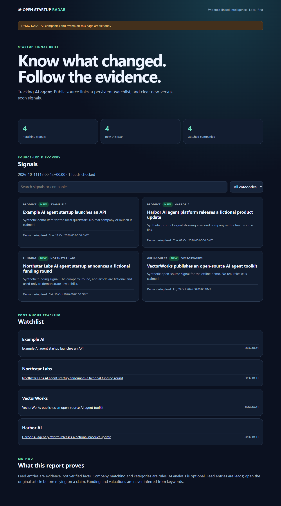

# Open Startup Radar

**Know what changed across AI startups. Follow the evidence.**

Open Startup Radar is an open source, local-first tool for following startup signals. Give it a topic, public RSS/Atom feeds, and an optional company watchlist. It collects source-linked items, removes duplicate links, remembers what it has seen, and shows what is new in a responsive dashboard and Markdown/JSON reports. An optional OpenAI brief can summarize only the collected evidence.

> **What makes this different?** The output is a persistent watchlist and a *new vs. seen* change brief, not a one-off news dump. Every signal points back to its source. The offline demo needs no account, API key, or network access.

[中文说明](README.zh-CN.md) · [Architecture](docs/ARCHITECTURE.md) · [Contributing](CONTRIBUTING.md)

**[Explore the interactive demo](https://jinfengkj-byte.github.io/open-startup-radar/)** · fictional data, no signup



*Offline demo screenshot. All companies and events shown are fictional.*

## Try it in one minute

Requires Python 3.10+.

```bash
git clone https://github.com/jinfengkj-byte/open-startup-radar.git
cd open-startup-radar
python -m pip install -e .
startup-radar demo --output output
startup-radar serve --output output
```

Open **http://127.0.0.1:8000/**. Run `startup-radar demo --output output` a second time: the new-signal count changes from **4 to 0**, because the local SQLite history remembers the source links. The example feed is synthetic and is never presented as a real startup event.

## Follow live sources

```bash
startup-radar scan --config config.example.json --output output
startup-radar serve --output output
```

Edit the example config to set your topic, feed URLs, and companies. `companies` may include aliases and website links. Your report is saved as `output/index.html`, `output/report.md`, and `output/report.json`; `output/history.sqlite` stores the seen-link history. The generated HTML also opens directly from disk, so the local server is optional.

```json
{
  "topic": "AI",
  "feeds": [{"name": "Public feed", "url": "https://example.org/feed.xml"}],
  "companies": [{"name": "Example AI", "aliases": ["ExampleAI"], "website": "https://example.org"}]
}
```

Public feed coverage varies. Add sources you trust and observe their terms of use. The tool keeps short feed summaries and original links; it does not download full articles.

## Optional AI brief

The core workflow is free and deterministic. If you have an OpenAI API key, you can explicitly opt in to a model-written brief:

```bash
# Set OPENAI_API_KEY in your environment first.
startup-radar scan --config config.example.json --output output --ai
```

`--ai` makes a paid API request only when specified. The model receives at most 20 collected items. The brief is required to cite URLs from those items; an output with an unknown citation is rejected. The default model is `gpt-4o-mini` and can be changed with `--model`. Model prose still needs human review; a citation proves where a statement came from, not that the source is true. No key is sent in the offline or standard scan modes.

## Outputs and interpretation

| Output | Use |
| --- | --- |
| `index.html` | Searchable dashboard, category filters, watchlist, new/seen counts |
| `report.md` | Shareable evidence-linked brief |
| `report.json` | Structured signals for other tools |
| `history.sqlite` | Local first-seen and last-seen event history |

Company matching, topic relevance, and categories use transparent text rules. They can miss events or match the wrong company. Funding amounts, valuations, founders, and trend scores are **not** invented. Open the original sources before making decisions. When all feeds fail, the command fails; partial feed errors are recorded in JSON.

## Automation and development

The **Research report** GitHub Action can be run manually with a topic and uploads an artifact. It never commits research results to the repository. CI runs parser and history tests on push and pull request.

```bash
python -m unittest discover -s tests -v
```

This public product grew from the author's daily **AI 创业雷达** research and report workflow. Its private scheduler, email settings, local font paths, and historical PDFs are not required here. See the [architecture notes](docs/ARCHITECTURE.md) for extension points.

## Roadmap

- More opt-in, terms-compliant source adapters and better entity resolution.
- Portable PDF export based on the existing 8-page visual report, plus scheduled local runs.
- Evaluation datasets for company matching and citation quality.

These are planned features, not claims about the current release. Contributions and reproducible bug reports are welcome. MIT licensed.
